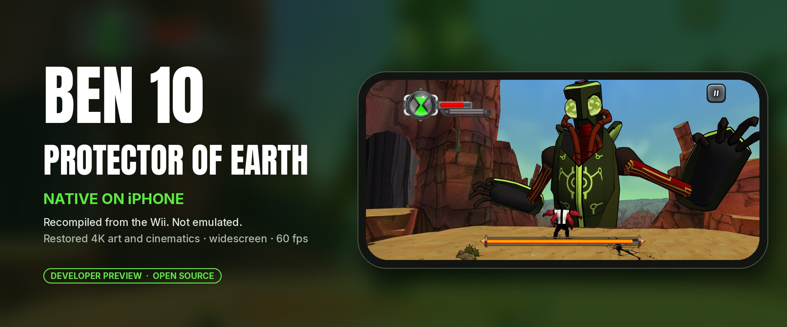
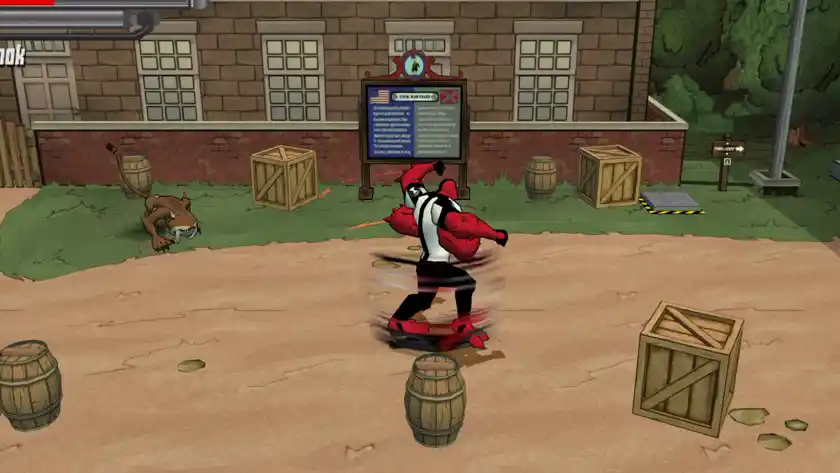
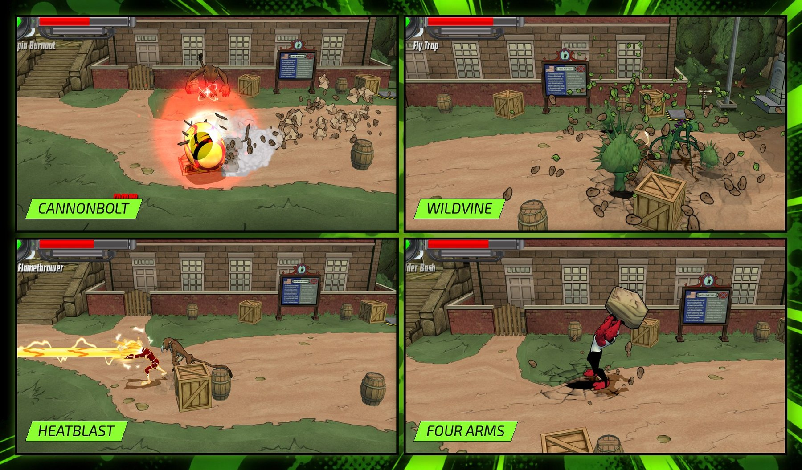
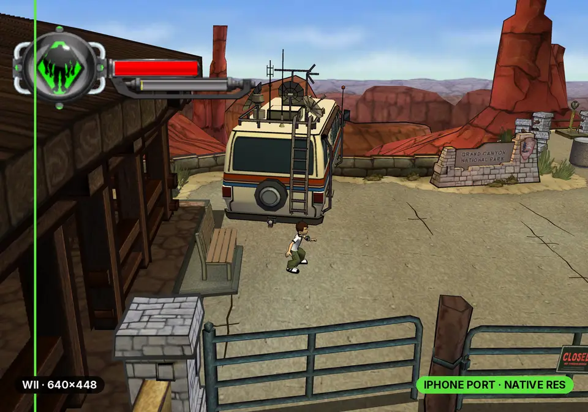
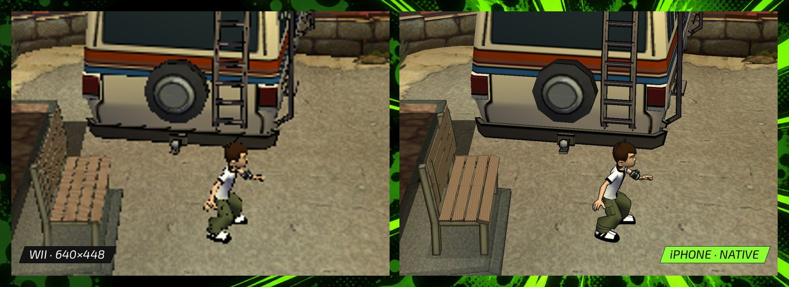
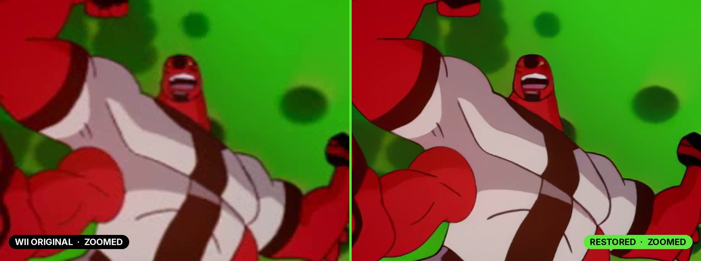

<p align="center">
  
</p>

# Ben 10: Protector of Earth for iPhone

I ported the 2007 Wii game *Ben 10: Protector of Earth* to the iPhone. The
game's PowerPC code is recompiled ahead of time into ARM64 and built into a
normal iOS app, with a small runtime standing in for the Wii's graphics, sound
and disc drive. There's no emulator running underneath.

The levels, enemies and difficulty are the original game's. What changes is how
it looks and plays on a phone: the textures and cutscenes are rebuilt at much
higher resolution, the camera is widescreen, and there are touch controls.

There's no game in this repository. You build the app and its content from your
own disc on your own Mac, then sideload it onto your iPhone.

<p align="center">
  
</p>

## What's different from the Wii version

- 2,221 textures are rebuilt at up to 4096×4096, upscaled from the game's own
  textures with open models (Real-ESRGAN, PBRify, ArtCNN and HDcube). Another 77
  HUD, sign and font textures were redrawn as vector art traced from the
  originals.
- All 76 cutscenes are upscaled from 640×480 to 2880×2160.
- The camera shows the full width of the phone's screen.
- It renders at close to the phone's own resolution. The game logic still runs
  at its original 30 updates a second; on an iPhone 18 Pro the picture is
  smoothed to 60 fps, dropping to a steady 30 in the heaviest scenes.
- Touch controls are laid out for a phone, and MFi, Xbox and PlayStation
  controllers work too. Moves that needed a Wii Remote shake are buttons.
- You can back up and restore your saves from the start screen.

## Screenshots

<p align="center">
  
</p>

The same Canyon frame on the Wii (640×448) and on the iPhone:

<p align="center">
  
</p>

<p align="center">
  
</p>

The Four Arms transformation cutscene, original and restored:

<p align="center">
  
</p>

## Status

This is a developer preview. I've played the fort, the canyon and the final boss
on my iPhone 18 Pro and spot-checked every other level. The full conversion has
only ever run on one Mac (an M4 Pro with 48 GB of memory, macOS 27, Xcode 27),
so it may well break on yours. If it does, please open a build report and
include the receipt file the tool names.

Before you start:

- The conversion is slow. Restoring the cutscenes took about 12 hours on the M4
  Pro, and the textures take many more. Leave it running overnight. If a step
  stops, rerunning it picks up where it left off.
- Your Mac won't reproduce my textures bit for bit, because the upscaling models
  round slightly differently on every Mac. So each rebuilt texture is checked
  against the original from your own disc instead, and only differences the
  size of rounding get through. If a texture really is wrong, the step stops and
  names it. I've tested this by rebuilding textures with different settings on
  my Mac, but not yet on a second Mac.
- It's iPhone only for now. I've only tested an iPhone 18 Pro; older models may
  not keep up.

## How it was made

I built this over about twelve weeks by directing AI coding agents, mostly
Claude and Codex. They wrote the runtime, the renderer and the tools; I set the
goals, made the calls and tested every build on my phone. The recompiler
underneath is [DolRecomp](https://github.com/ExpansionPak/DolRecomp), a
human-written open-source project, and disc extraction uses
[nod](https://github.com/encounter/nod). The kit contains no console keys.

## What you need

- An Apple Silicon Mac with **at least 80 GB free**, full Xcode with the iOS SDK,
  [CMake](https://cmake.org), [Ninja](https://ninja-build.org),
  [uv](https://docs.astral.sh/uv/) with Python 3.14 (`uv python install 3.14`),
  and [FFmpeg](https://ffmpeg.org) with VideoToolbox HEVC support and `ffprobe`
  on your PATH. You also need [cairo](https://www.cairographics.org) 1.18.4
  (Homebrew has it).
- An iPhone with about **25 GB free** for the content and its import.
- An Apple ID to sign the app for your phone. A free one works, but its
  signature lasts 7 days, so you'll re-sign weekly. See
  [Put it on your iPhone](#put-it-on-your-iphone).
- A disc image (`.rvz` or `.iso`) of the USA release, game ID `RBNEG9`,
  revision 0.
- Five upscaling model files (about 244 MB), which you download yourself from
  their official sources. Step 4 has the links.
- The artwork bundle `authored-inputs.zip` from this repository's
  [Releases](../../releases) page.

<a id="build-it"></a>

## Build it

Set these once in your terminal. Keep every path **outside** this repository.

```sh
export KIT="$PWD"                         # this repository
export WORK="$HOME/Protector-work"        # all generated files
export GAME="$HOME/Games/Ben 10 - Protector of Earth (USA).rvz"
export MODELS="$HOME/Protector-models"
export UV_PYTHON=3.14                     # the version conversion was qualified with
mkdir -p "$WORK" "$MODELS"
```

**1. Get the artwork bundle.** Download `authored-inputs.zip` from Releases and
unzip it next to this repository, so the folder is `../authored-inputs`. Then
check it:

```sh
uv run python tools/export_personal_authored_inputs.py verify ../authored-inputs
```

**2. Check your Mac and fetch the tools.** This downloads and checks the pinned
disc extractor, texture encoder and recompiler source, builds the recompiler,
and fetches Dolphin's free replacement DSP table.

```sh
uv run python tools/personal_build.py doctor --cinematics
uv run python tools/bootstrap_personal_tools.py --work-dir "$WORK/tools"
```

**3. Build the app from your disc.** Pick your own bundle ID and never change
it. A different ID installs as a separate app, without your content or saves.

```sh
uv run python tools/personal_build.py prepare --input "$GAME" --work-dir "$WORK/build" \
  --nodtool "$WORK/tools/bin/nodtool" --dolrecomp "$WORK/tools/build/dolrecomp"
uv run python tools/personal_build.py build --work-dir "$WORK/build" \
  --coefficients "$WORK/tools/downloads/dsp_coef.bin" --sdk iphoneos --bundle-id com.yourname.protector \
  --authored-inputs ../authored-inputs
uv run python tools/personal_build.py ipa --app "$WORK/build/build-iphoneos/protector_ios_interactive.app" \
  --output "$WORK/Protector-unsigned.ipa"
```

The builder only accepts `RBNEG9` revision 0, and draws the app icon from the
artwork bundle. The IPA it makes contains code translated from your copy of the
game, so keep it to yourself.

**4. Download the models** into `$MODELS` and keep these exact filenames. Check
each project's terms first.

| File | Source | Bytes |
| --- | --- | ---: |
| `4x-PBRify_UpscalerV4.safetensors` | [PBRify V4](https://github.com/Kim2091/Kim2091-Models/releases/download/4x-PBRify_UpscalerV4/4x-PBRify_UpscalerV4.safetensors) | 139,793,020 |
| `ArtCNN_R16F96.onnx` | [ArtCNN](https://raw.githubusercontent.com/Artoriuz/ArtCNN/e138cc15c0d9fb6ec04b86fc453f7faa30e2b5d3/ONNX/ArtCNN_R16F96.onnx) | 16,313,082 |
| `4xHDcube3_500k.pth` | [HDcube 3.0](https://github.com/Venomalia/HDcube/releases/download/3.0/4xHDcube3_500k.pth) | 67,020,101 |
| `RealESRGAN_x4plus_anime_6B.pth` | [Real-ESRGAN v0.2.2.4](https://github.com/xinntao/Real-ESRGAN/releases/download/v0.2.2.4/RealESRGAN_x4plus_anime_6B.pth) | 17,938,799 |
| `realesr-animevideov3.pth` | [Real-ESRGAN v0.2.5.0](https://github.com/xinntao/Real-ESRGAN/releases/download/v0.2.5.0/realesr-animevideov3.pth) | 2,504,012 |

```sh
uv run python tools/check_personal_models.py --model-dir "$MODELS"
```

**5. Rebuild the models.**

```sh
uv run --with-requirements requirements-personal.lock python tools/personal_geometry.py \
  --game "$WORK/build/extracted" --work-dir "$WORK/geometry"
mkdir -p "$WORK/EnhancedModels" && ln "$WORK/geometry/geometry.json" "$WORK/EnhancedModels/geometry.json"
```

**6. Restore the cutscenes**, then encode them for the phone.

```sh
uv run --with-requirements requirements-personal.lock python tools/personal_cinematics.py \
  --game "$WORK/build/extracted" --work-dir "$WORK/movies" --model-dir "$MODELS" --run
uv run python tools/personal_cinematic_delivery.py --work-dir "$WORK/movies" --output "$WORK/movie-delivery"
```

**7. Rebuild the textures**, then compress and assemble them.

```sh
uv run python tools/personal_convert_textures.py stages --game "$WORK/build/extracted" \
  --work-dir "$WORK/textures" --model-dir "$MODELS" --authored-inputs ../authored-inputs
uv run python tools/personal_convert_textures.py deliver --game "$WORK/build/extracted" \
  --work-dir "$WORK/textures" --delivery-dir "$WORK/texture-delivery" --cooked-dir "$WORK/texture-cooked" \
  --output "$WORK/RestoredArt" --astcenc "$WORK/tools/bin/astcenc"
```

Add `--dry-run` to either command to list every step it will run. If a stage
stops, its failure receipt is in the work directory, and rerunning continues
from there.

**8. Package your content.**

```sh
uv run python tools/package_personal_content.py create --game "$WORK/build/extracted" \
  --restoredart "$WORK/RestoredArt" --enhancedmodels "$WORK/EnhancedModels" \
  --restoredcinematics "$WORK/movie-delivery/RestoredCinematics" --output "$WORK/Protector.pnc"
```

The package is about 10 GB. Once it verifies, you can delete the working
folders except `$WORK/build` and `$WORK/tools`, which updates reuse.

<a id="put-it-on-your-iphone"></a>

## Put it on your iPhone

iOS only runs apps that are signed for your phone, so the app needs signing
with your Apple ID before it will install. Pick one way and stick with it. Every
update and re-sign has to use the same bundle ID and the same Apple ID, or iOS
either refuses the update or installs a second, empty copy of the app.

On the iPhone, turn on **Developer Mode** (Settings → Privacy & Security →
Developer Mode, then restart and confirm). The switch only shows up after the
phone has been connected to Xcode once, so do step 2 below first if you can't
find it.

### With Xcode (recommended)

This signs in with Apple directly, so it isn't affected by the sign-in failures
the sideloading apps are having at the moment. A free Apple ID gives a 7-day
signature; a paid developer account ($99 a year) gives a year. I've used this
path with a paid account; a free account's profile works the same way, but I
haven't tried one.

1. In Xcode, open **Settings → Apple Accounts** and add your Apple ID.
2. Get Xcode to make a signing profile for your bundle ID. Create a throwaway
   project (**File → New → Project → iOS → App**), set its **Bundle Identifier**
   to exactly the ID you built with and its **Team** to your Apple ID. Connect
   your iPhone, pick it as the destination and press **⌘B** to build. Don't press
   Run: the throwaway app has the same bundle ID as the game, so installing it
   would put it in the game's place.
3. Sign the game and install it:

```sh
xcrun devicectl list devices              # copy your iPhone's identifier
rm -rf "$WORK/Protector-signed.app"
uv run python tools/personal_sign.py --app "$WORK/build/build-iphoneos/protector_ios_interactive.app" \
  --output "$WORK/Protector-signed.app" --device YOUR_DEVICE_ID --install
```

The first time, iOS may say the developer isn't trusted. Open **Settings →
General → VPN & Device Management**, tap your Apple ID and trust it.

With a free Apple ID, do this every week: open the throwaway project, press
**⌘B** with the phone connected to renew the profile, then rerun the commands in
step 3.

### With AltStore, SideStore or Sideloadly

These sign with a free Apple ID and can refresh the app for you. Install
`Protector-unsigned.ipa` from step 3 of *Build it*:

- [AltStore Classic](https://altstore.io): hold Option, click the AltServer icon
  in the menu bar and choose **Sideload .ipa**.
- [SideStore](https://sidestore.io): import the IPA in the app, after the
  one-time setup with iloader.
- [Sideloadly](https://sideloadly.io): drag the IPA in. On Apple Silicon it
  needs Rosetta.

Since mid-October 2026, Apple sign-in has been failing in all three for a lot
of people, with errors like -80045, -80046 or 503 (AltStore is tracking it
[here](https://github.com/altstoreio/AltStore/issues/1828)). If you hit that,
use Xcode instead. Note that AltStore and SideStore add your team ID to the end
of the bundle ID, and Sideloadly can change it too. An app installed by one of
them is a different app from one installed by Xcode, with its own content and
saves.

A free Apple ID allows 3 sideloaded apps per phone and 10 new app IDs a week.

## Import the content and play

1. Connect the iPhone to your Mac, open Finder, select the iPhone, open
   **Files**, and drag `Protector.pnc` onto **Protector Native**.
2. Open the app, tap **Choose content package** and pick the file. Keep the
   screen on while it verifies and imports. Afterwards you can delete the
   copied `.pnc` from Files to free the space.
3. Tap **Play**. Touch controls appear on screen, and a connected controller
   takes over automatically.

## Updates, re-signing and saves

Always install new builds and weekly re-signs **over** the existing app, with
the same bundle ID and the same Apple ID. Deleting the app deletes the imported
content and your saves. Before anything risky, open **Save backups → Back up
saved progress** on the start screen and keep the `.pnsave` file somewhere
outside the app, such as iCloud Drive.

To update, pull this repository, rerun step 3 of *Build it* with the same
`--bundle-id`, and sign and install the new build the same way as before. Your
content stays imported.

Every tool, its checks and its receipts are described in
[docs/PERSONAL_BUILD_KIT.md](docs/PERSONAL_BUILD_KIT.md).

## FAQ

**Can I just download the app?** No. The app contains code translated from the
game, so I can't distribute it. Everyone builds their own from a disc they own.

**Is this an emulator?** No. An emulator reads the Wii's PowerPC instructions
while you play. Here they're translated once, ahead of time, into ARM64 code
that's compiled into the app.

**Why does it need a Mac?** Xcode, the recompiler and the upscaling models all
run on macOS, and rebuilding the art and cutscenes takes hours of GPU time.

**iPad, Android or PC?** Not in this preview.

**Does it play differently?** No. The levels, enemies and difficulty are the
original's. The graphics, controls and menus are new.

## Licence

This project's own code is free software under the
[GNU General Public License v3.0 or later](LICENSE). Parts derived from
[Dolphin](https://dolphin-emu.org) keep their GPL-2.0-or-later notices, and the
recompiler interface follows DolRecomp (GPL-3.0-or-later). Details are in
[LICENSING.md](LICENSING.md) and [native/licenses](native/licenses/README.md).

The licence covers this project's code only. It gives no rights in Ben 10, the
game, or anything built from it. The artwork bundle on the Releases page holds
redrawn and traced game artwork and recipes, so that people who own the game can
rebuild the enhanced edition; it isn't covered by the GPL. Model weights aren't
included, and each model has its own terms.

This is an unofficial fan project, not affiliated with or endorsed by Warner
Bros. Discovery, Cartoon Network, the game's publisher or its developer. Ben 10
and related names and characters are trademarks of their owners. If you hold
rights in any of this and have a concern, open an issue or contact me through
GitHub.
