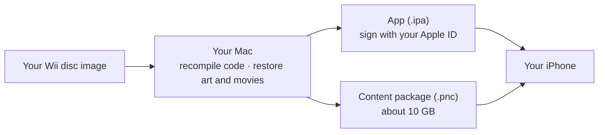

<p align="center">
  
</p>

<h1 align="center">Ben 10: Protector of Earth, native on iPhone</h1>

<p align="center">
  <b>The 2007 Wii game, recompiled to run natively on iPhone. Not emulated.</b><br>
  Restored 4K-class art and cinematics · widescreen · 60 fps · touch and controller
</p>

<p align="center">
  <a href="#build-it"></a>
  
  
  <a href="LICENSE"></a>
</p>

<p align="center">
  
</p>

It's hero time, in your pocket. *Protector of Earth* never left the Wii. This
project takes your own copy of the disc and turns it into a real iPhone app.
The game's original PowerPC code is translated ahead of time into native ARM64
on your Mac, so every level, alien and boss plays exactly as it did in 2007.
Then it gets the remaster it never had.

## Every alien, every power

<p align="center">
  
</p>

## Wii → iPhone

<p align="center">
  
</p>

<p align="center">
  
</p>

Every cinematic is restored from 640×480 to 2880×2160, frame for frame:

<p align="center">
  
</p>

## What's new

| | |
| --- | --- |
| **Native, not emulated** | The game's code is recompiled to ARM64 once, on your Mac. No interpreter, no JIT, nothing to tune. |
| **Restored art** | 2,221 textures rebuilt at up to 4096 × 4096, with model detail and line art redone for high-DPI screens. |
| **Restored cinematics** | All 76 movies rebuilt at 2880 × 2160 from the originals, frame-accurate. |
| **Widescreen** | The camera sees the full width of your phone, with the HUD where it belongs. |
| **Smooth** | 60 fps presentation with motion smoothing over the original 30 Hz gameplay, rendered at near-native resolution. |
| **Made for touch** | A native touch layout designed for phones, plus game controllers (MFi, Xbox, PlayStation). The Wii remote waggle is a button now. |
| **Your saves, safe** | Back up and restore progress from the start screen; updates never touch your saves. |

## How it works



## How this was made

This port was built over twelve weeks by AI coding agents (Anthropic's Claude
and OpenAI's Codex) working under my direction. I set the goals, made the
product and release calls, and tested every build on a real iPhone. The
agents wrote the runtime, the renderer, the tooling and these docs. The
recompiler itself is [DolRecomp](https://github.com/ExpansionPak/DolRecomp),
an open-source, human-written project; Wii disc extraction uses the
open-source [nod](https://github.com/encounter/nod). The kit contains no
console keys.

The enhanced art and cinematics are restored from the game's own originals
with open upscaling models (Real-ESRGAN, PBRify, ArtCNN, HDcube), run on your
Mac. Nothing is generated from scratch. A small set of HUD, sign and font
textures were redrawn as vector art traced from the originals; those 77 files
are in the release download, outside the GPL.

How it was checked, rather than taken on trust:

- Every main level has a representative check, and the Fort, the Canyon and
  the final boss have been played on an iPhone 18 Pro, with saves surviving
  every update.
- Over 1,600 automated tests cover the runtime, renderer and tools.
- Every restored texture and movie must match a recorded hash before it is
  accepted, so a bad output stops the build instead of reaching your phone.
- Known issues and everything not yet verified are listed in the Status
  section below, not left out.

The repository contains **no game**: only source code and the tools that turn
*your own copy* into an app and a content package for *your own* iPhone. You
need a disc image of the USA release (game ID `RBNEG9`, revision 0) that you
are entitled to use. Nothing here downloads, shares or bundles game data, and
nothing you build should be shared with anyone else.

> Protector Native is an unofficial fan project. It is not affiliated with,
> endorsed or sponsored by Warner Bros. Discovery, Cartoon Network, the game's
> publisher or its developer. Ben 10 and related names and characters are
> trademarks of their respective owners.

## Status: developer preview

Every main level has been spot-checked, and the fort, the canyon and the final
boss have been played on an iPhone 18 Pro running at 60 fps. Conversion has been run on one
Mac: an M4 Pro with 48 GB of memory, running macOS 27 and Xcode 27. Nobody has
yet converted it on a second machine, which is why this is a developer preview.
If it fails on yours, please open an issue with the receipt file the tool names.

What to expect before you start:

- **Conversion takes a long time.** Restoring the 76 cinematics alone took about
  0.6 seconds per frame on the M4 Pro, roughly 12 hours for the library. Texture
  reconstruction adds many more hours. Plan to leave it running overnight at
  minimum. Every step resumes where it stopped.
- **Other Macs may stop with an "unknown output" error.** Texture outputs are
  admitted only if they exactly match, or match a listed one-unit rounding
  variant of, what was qualified on the development Mac. A different chip or
  macOS version can round differently. The tool stops instead of accepting
  unverified art. Report it with the failure receipt.
- **iPhone only.** iPad is not supported in this preview. Recent Pro iPhones are
  recommended; older models are untested.
- **Known rough edges:** the Omnimax pickup transition and some distant object
  popping are still being checked; the phone runs warm in long sessions; the app
  has no icon yet.

## What you need

- An Apple Silicon Mac with **at least 80 GB free**, full Xcode with the iOS SDK,
  [CMake](https://cmake.org), [Ninja](https://ninja-build.org),
  [uv](https://docs.astral.sh/uv/) with Python 3.14 (`uv python install 3.14`), and [FFmpeg](https://ffmpeg.org) with
  VideoToolbox HEVC support and `ffprobe` on your PATH. Install
  [cairo](https://www.cairographics.org) 1.18.4 (for example with Homebrew).
- An iPhone with about **25 GB free** for the content and its import.
- A way to sign apps for your own phone: a free Apple ID with
  [Sideloadly](https://sideloadly.io) or [AltStore](https://altstore.io), or a
  paid Apple Developer account. Free signatures expire every 7 days and must be
  refreshed.
- Your disc image (`.rvz` or `.iso`) of `RBNEG9` revision 0.
- Five upscaling model files (about 244 MB), downloaded by you from their
  official sources. The exact links and sizes are in step 4.
- The artwork bundle `authored-inputs.zip` from this repository's
  [Releases](../../releases) page.

<a id="build-it"></a>

## Build it

Set these once in your terminal. Every path should be **outside** this
repository.

```sh
export KIT="$PWD"                         # this repository
export WORK="$HOME/Protector-work"        # all generated files
export GAME="$HOME/Games/Ben 10 - Protector of Earth (USA).rvz"
export MODELS="$HOME/Protector-models"
export UV_PYTHON=3.14                     # the version conversion was qualified with
mkdir -p "$WORK" "$MODELS"
```

**1. Get the artwork bundle.** Download `authored-inputs.zip` from Releases and
unzip it next to this repository, so the folder is `../authored-inputs`. Then
verify it:

```sh
uv run python tools/export_personal_authored_inputs.py verify ../authored-inputs
```

**2. Check your Mac and fetch the pinned tools.** This downloads and checks the
pinned disc extractor, texture encoder and recompiler source, builds the
recompiler, and fetches Dolphin's free replacement DSP table.

```sh
uv run python tools/personal_build.py doctor --cinematics
uv run python tools/bootstrap_personal_tools.py --work-dir "$WORK/tools"
```

**3. Build the app from your disc.** Choose your own bundle ID and keep it the
same forever. Changing it later means installing a separate app, without your
content or saves.

```sh
uv run python tools/personal_build.py prepare --input "$GAME" --work-dir "$WORK/build" \
  --nodtool "$WORK/tools/bin/nodtool" --dolrecomp "$WORK/tools/build/dolrecomp"
uv run python tools/personal_build.py build --work-dir "$WORK/build" \
  --coefficients "$WORK/tools/downloads/dsp_coef.bin" --sdk iphoneos --bundle-id com.yourname.protector
uv run python tools/personal_build.py ipa --app "$WORK/build/build-iphoneos/protector_ios_interactive.app" \
  --output "$WORK/Protector-unsigned.ipa"
```

The builder rejects any disc other than `RBNEG9` revision 0. The resulting IPA
contains code translated from your game: it is for your phone only.

**4. Download the models** into `$MODELS`, keeping these exact filenames.
Review each project's terms first.

| File | Source | Bytes |
| --- | --- | ---: |
| `4x-PBRify_UpscalerV4.safetensors` | [PBRify V4](https://github.com/Kim2091/Kim2091-Models/releases/download/4x-PBRify_UpscalerV4/4x-PBRify_UpscalerV4.safetensors) | 139,793,020 |
| `ArtCNN_R16F96.onnx` | [ArtCNN](https://raw.githubusercontent.com/Artoriuz/ArtCNN/e138cc15c0d9fb6ec04b86fc453f7faa30e2b5d3/ONNX/ArtCNN_R16F96.onnx) | 16,313,082 |
| `4xHDcube3_500k.pth` | [HDcube 3.0](https://github.com/Venomalia/HDcube/releases/download/3.0/4xHDcube3_500k.pth) | 67,020,101 |
| `RealESRGAN_x4plus_anime_6B.pth` | [Real-ESRGAN v0.2.2.4](https://github.com/xinntao/Real-ESRGAN/releases/download/v0.2.2.4/RealESRGAN_x4plus_anime_6B.pth) | 17,938,799 |
| `realesr-animevideov3.pth` | [Real-ESRGAN v0.2.5.0](https://github.com/xinntao/Real-ESRGAN/releases/download/v0.2.5.0/realesr-animevideov3.pth) | 2,504,012 |

```sh
uv run python tools/check_personal_models.py --model-dir "$MODELS"
```

**5. Rebuild the models.**

```sh
uv run --with-requirements requirements-personal.lock python tools/personal_geometry.py \
  --game "$WORK/build/extracted" --work-dir "$WORK/geometry"
mkdir -p "$WORK/EnhancedModels" && ln "$WORK/geometry/geometry.json" "$WORK/EnhancedModels/geometry.json"
```

**6. Restore the cinematics**, then encode them for the phone.

```sh
uv run --with-requirements requirements-personal.lock python tools/personal_cinematics.py \
  --game "$WORK/build/extracted" --work-dir "$WORK/movies" --model-dir "$MODELS" --run
uv run python tools/personal_cinematic_delivery.py --work-dir "$WORK/movies" --output "$WORK/movie-delivery"
```

**7. Rebuild the textures**, then compress and assemble them.

```sh
uv run python tools/personal_convert_textures.py stages --game "$WORK/build/extracted" \
  --work-dir "$WORK/textures" --model-dir "$MODELS" --authored-inputs ../authored-inputs
uv run python tools/personal_convert_textures.py deliver --game "$WORK/build/extracted" \
  --work-dir "$WORK/textures" --delivery-dir "$WORK/texture-delivery" --cooked-dir "$WORK/texture-cooked" \
  --output "$WORK/RestoredArt" --astcenc "$WORK/tools/bin/astcenc"
```

Add `--dry-run` to either command to see every step it will run. If a stage
stops, its failure receipt is in the work directory; rerunning continues from
the completed work.

**8. Package your content.**

```sh
uv run python tools/package_personal_content.py create --game "$WORK/build/extracted" \
  --restoredart "$WORK/RestoredArt" --enhancedmodels "$WORK/EnhancedModels" \
  --restoredcinematics "$WORK/movie-delivery/RestoredCinematics" --output "$WORK/Protector.pnc"
```

The package is about 10 GB. Once it verifies, you can delete the working
folders except `$WORK/build` and `$WORK/tools`, which updates reuse.

## Install and play

1. Sign and install `Protector-unsigned.ipa` with Sideloadly, AltStore or your
   developer account.
2. Connect the iPhone to your Mac, open Finder, select the iPhone, open
   **Files**, and drag `Protector.pnc` onto **Protector Native**.
3. Open the app, tap **Choose content package**, pick the file and keep the
   screen open while it verifies and imports. You can then delete the transferred
   `.pnc` copy from Files to free space.
4. Tap **Play**. Touch controls appear on screen; a connected game controller
   takes over automatically.

## Updates, refreshes and saves

Always install new builds and signature refreshes **over** the existing app with
the same bundle ID. Never delete the app to update it: deleting removes the
imported content and your saves. Before any risky change, open **Save backups →
Back up saved progress** on the start screen and keep the `.pnsave` file
outside the app, for example in iCloud Drive.

To update, pull this repository, rerun step 3 of *Build it* with the same
`--bundle-id`, then sign and install the new IPA over the existing app. Your
content stays imported.

More detail on every tool, its checks and its receipts is in
[docs/PERSONAL_BUILD_KIT.md](docs/PERSONAL_BUILD_KIT.md).

## FAQ

**Can I just download the app?** No. The app contains code translated from the
game, so it can only be built by someone who owns the game, for themselves.
That is the whole point of the kit.

**Is this an emulator?** No. An emulator interprets the Wii's PowerPC
instructions while you play. Here they are translated once, ahead of time, into
native ARM64 code that is compiled into the app, with a small runtime standing
in for the Wii's hardware.

**Why does it need a Mac?** The recompiler, Xcode and the restoration models all
run on macOS. Restoring the art and cinematics is the slow part.

**iPad? Android? PC?** Not in this preview.

**Is anything changed from the original?** The game logic, levels and difficulty
are the original's. The visuals, controls and menus are upgraded.

## Licence

The original Protector Native software is free software under the
[GNU General Public License v3.0 or later](LICENSE). Portions derived from
[Dolphin](https://dolphin-emu.org) keep their GPL-2.0-or-later notices, and the
recompiler interface follows DolRecomp (GPL-3.0-or-later); see
[LICENSING.md](LICENSING.md) and [native/licenses](native/licenses/README.md).

The licence covers this project's software only. It grants no rights in Ben 10,
the original game or anything converted from it. The artwork bundle on the
Releases page contains redrawn and traced game artwork and recipes. It is
provided so owners of the game can reconstruct the enhanced edition, and it is
not covered by the GPL. Model weights are not included; each model has its own
terms.

Rights holders with concerns can open an issue or contact the maintainer
through GitHub, and the material in question will be reviewed promptly.
